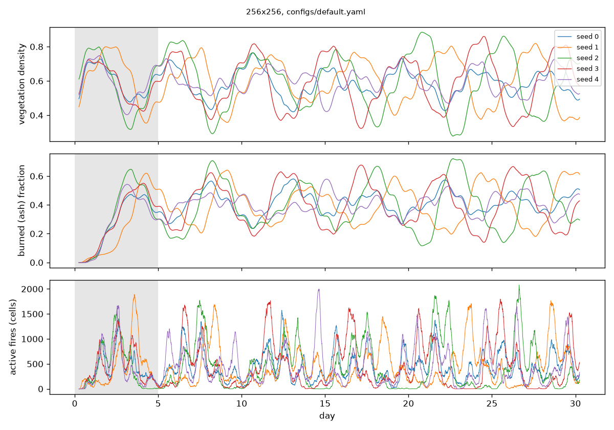
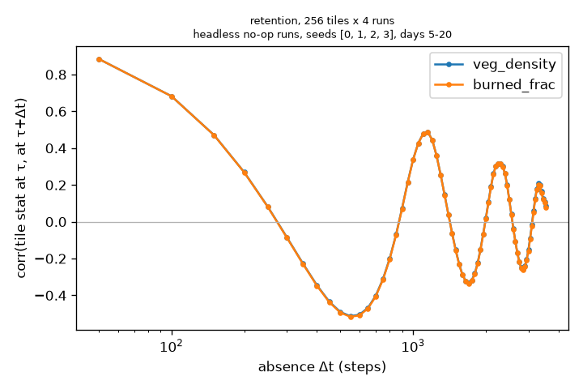

# Wildfire testbed

Interactive 2D wildfire game and ground-truth simulator for experiments in partially observed
environments. The full specification is in [SPEC.md](SPEC.md).

## Install and run

```bash
uv sync
uv run pytest
uv run python -m wildfire.cli run --config configs/default.yaml --steps 2000
uv run python -m wildfire.app.play --seed 0     # play
uv run python -m wildfire.cli generate --config configs/default.yaml --policy explore_return \
    --episodes 10 --steps 2000 --out data/test
uv run python -m wildfire.cli replay data/test/ep_0000
```

## Environment API

```python
from wildfire import Config, WildfireEnv, VecWildfire

env = WildfireEnv(Config.from_yaml("configs/default.yaml"))
obs, info = env.reset(seed=0)  # obs: grid (V, V, 6), rgb, light, agent{facing, tank}
obs, reward, terminated, truncated, info = env.step(action)
state = env.get_state()  # privileged WorldState (copy)
env.set_state(state)
futures = env.fork(n=16, steps=200)  # batched WorldState (16, H, W), one stream id per future
vec = VecWildfire(cfg, n=8)  # steps 8 worlds with arrays (8, H, W)
```

`info` holds `step`, the agent's own position `pos`, the tiles intersecting the window and the
per-tile `first_seen` / `last_seen` steps (−1 = never). Gymnasium spaces are defined when the
optional `gym` extra is installed (`uv sync --extra gym`).

Episode directories follow SPEC 9 (`meta.json`, `actions.npy`, `agent.npy`, `obs_grid.npy`,
optional `obs_rgb.npy`, `tiles_seen.npy` with shape `(2, rows, cols)` = first/last seen,
`state/step_XXXXXX.npz` every `snapshot_every` episode steps plus the final step).
`EpisodeDataset(root)` loads them with NumPy (memory-mapped).

## Browser version

`web/` is a browser build of the game: `web/wildfire.js` is a JavaScript port of the
simulation core (RNG, terrain, actions, step, observation buckets, colours) and
`web/index.html` is the frontend (agent and god view, last-seen overlay, minimap, inspector,
pause/step/speed, reset, save/load in browser storage, fork preview in Web Workers, touch
controls). F2 recording is Python-only. The port is checked bit for bit against the Python
package by `tests/test_web_parity.py`, which runs `web/parity.js` under Node. Covered: 64 × 64
with high lightning (600 steps), 40 × 70 with day length 50 and tank 3 (400 steps), and the
default 256 × 256 (300 steps), with random moves, ignite and water, plus fork stream ids. The
test is skipped if `node` is not installed. Any change to the Python rules must be mirrored in
`web/wildfire.js`; the parity test fails otherwise. To run it locally:

```bash
python3 -m http.server 8765 --directory web    # then open http://localhost:8765
```

Every push to `main` deploys it to GitHub Pages: https://jkneifl.github.io/Wildfire-Simulator/
(`.github/workflows/pages.yml` wraps `web/index.html` in a full HTML document and copies
`wildfire.js`).

## Game controls

| key | action |
|---|---|
| arrows / WASD | move (repeats while held) |
| F / Space | ignite / water the cell in front |
| Tab | agent view / god view (mouse wheel zooms, right or middle drag pans) |
| G | last-seen overlay (agent view) |
| M / I | minimap / cell inspector (hover a cell) |
| P / N | pause / single step |
| + / − | simulation speed (2, 5, 10, 20, 40 steps/s) |
| R / Shift+R | reset with seed + 1 / the same seed |
| F5 / F9 | save / load `saves/quicksave.npz` |
| F2 | start or stop recording to `recordings/` |
| K | fork preview: burn probability over 16 futures × 100 steps (god view) |
| Esc | quit |

## Layout

| module | content |
|---|---|
| `config.py` | frozen `Config` dataclass, `Config.from_yaml` |
| `rng.py` | counter-based RNG: `fmix64(key(seed, stream, step, purpose) ^ cell_hash(y, x))` |
| `terrain.py` | value-noise terrain, rivers, initial vegetation, `initial_state` |
| `state.py` | `WorldState` (layers `(H, W)` or `(n, H, W)`), `stack`, `equal`, save/load |
| `actions.py` | action ids, `apply_action` (step 1 of the update) |
| `dynamics.py` | pure `step(state, action, cfg)`, `light(t, D)`, spread-weight hook |
| `observe.py` | window crop, observation buckets, `observe`, `privileged` |
| `render/palette.py`, `render/topdown.py` | palette; pure NumPy `render(state, window, cfg)` |
| `tiles.py` | tile indices, `tiles_in_window`, `extract_tile`, `TileTracker` |
| `env.py` | `WildfireEnv`, `VecWildfire`, `fork` |
| `record.py` | `Recorder`, `replay`, `EpisodeDataset` |
| `policies.py` | scripted policies |
| `metrics.py` | global and patch statistics, `simulate_stats`, `regime_summary` |
| `app/play.py` | pygame-ce frontend |
| `cli.py` | `run` (headless statistics), `generate`, `replay` |

## Performance

`step` on one CPU core (Apple Silicon, NumPy 2, `OMP_NUM_THREADS=1`), default parameters,
no-op actions, measured with `wildfire.cli run`:

| world | steps/s |
|---|---|
| 256 × 256 (2000 steps, seed 0), start defaults | 696 |
| 256 × 256 (2000 steps, seed 0), calibrated defaults | 621 |
| 2048 × 2048 (200 steps, seed 0, 23k–49k burning cells), start defaults | 11.2 |

Environment overhead on 256 × 256 (500 no-op steps, seed 0): `WildfireEnv` 637 steps/s without
and 522 with `rgb`; `VecWildfire(n=16)` 702 world-steps/s; `fork(16, 100)` 2.2 s.

## Scripted policies

`random_walk`, `explore_return` (observe a tile for 40 steps, leave until it is out of view,
stay away for a log-uniform `Δt` in 50–2000 steps without bringing it back into view, return;
`policy_log` in `meta.json` lists `{tile, leave_step, return_step, dt}`), `firestarter`
(random walk, ignites with probability 0.02 per step), `firefighter` (waters the nearest
visible fire, refills at the nearest visible water). All randomness uses purpose `POLICY`
with the policy's seed. `generate --epsilon ε` replaces the policy's action by a uniformly
random one with probability ε per step (`policies.random_action`), so the data also contains
actions without effect: blocked moves, water without fire in reach, ignite on bare ground.
`generate --bump p` walks into an adjacent obstacle (water, rock, world edge) with
probability p (`policies.bump_action`), since few steps are next to one.

## Calibration (M4)

`scripts/calibrate.py` runs headless no-op simulations on 256 × 256, 30 days each (7200
steps), excludes the first 5 days, and reports per seed: fraction of steps with at least one
burning cell, longest fire-free stretch, vegetation density and ash fraction of ground cells.
It plots the time series and the size distributions (CCDF) of 4-connected burned and vegetated
components in daily snapshots.

```bash
uv run python scripts/calibrate.py --seeds 0 1 2 3 4 --days 30 --out docs/calibration/calibrated
```

Starting defaults miss the target regime: on seeds 0–2, fire is active in only 64 % of steps,
with fire-free stretches up to 2.2 days, and vegetation swings between 11 % and 91 % in
map-wide boom-bust cycles. 15 `(beta, p_lightning)` combinations were tried (beta ∈ {0.05,
0.1, 0.2, 0.35}, p_lightning ∈ {2e-7, 5e-7, 1e-6, 2e-6, 5e-6, 1e-5}, 2 seeds, 30 days); all
other parameters are unchanged. More lightning removes the fire-free gaps; a lower `beta`
keeps fires from sweeping the connected forest. `beta = 0.2, p_lightning = 2e-6` also met the
numbers but showed a ~2-day oscillation that is nearly in phase across seeds; `beta = 0.1`
gives less synchronised, more local fires.

| parameter | start | calibrated |
|---|---|---|
| `beta` | 0.35 | **0.1** |
| `p_lightning` | 2e-7 | **1e-6** |

Means over seeds after the 5-day burn-in (256 × 256, 30 days; per-seed values in
`docs/calibration/*/summary.json`):

| config | seeds | steps with fire | longest fire-free | veg density min–mean–max | ash fraction mean / max | active fires (mean cells) |
|---|---|---|---|---|---|---|
| start defaults | 0–2 | 63.9 % | 2.17 days | 0.11 – 0.51 – 0.91 | 0.49 / 0.89 | 462 |
| calibrated | 0–4 | 97.5 % | 0.15 days (max 0.5, seed 3) | 0.36 – 0.60 – 0.81 | 0.40 / 0.64 | 438 |

Seeds 3 and 4 were not used for the choice; they agree with seeds 0–2. Ash persists for
roughly 2–3 days on average before a cell is reseeded (40 % ash cover at about 50 cells
burning out per step), which matches "burned areas regrow over a few days". Patch sizes are
broad and heavy-tailed (1 to ~3·10⁴ cells), without a clean power law; this is a
Drossel–Schwabl-like regime, not a verified critical state.

Plots: [time series](docs/calibration/calibrated/timeseries.png),
[patch sizes](docs/calibration/calibrated/patches.png); start defaults:
[time series](docs/calibration/initial_defaults/timeseries.png),
[patch sizes](docs/calibration/initial_defaults/patches.png).



## Evaluation utilities (M5)

`metrics.py`: `global_stats`, `patch_stats` (component sizes via `scipy.ndimage.label`),
`tile_stats` (per tile, over ground cells: vegetated fraction, mean stage / V_MAX, ash
fraction, burning fraction, mean wetness / 255; batched), `monte_carlo(state, cfg, steps, n,
tiles)` (tile statistics of `n` forked futures), `burn_probability` (used by the K preview),
`retention_curve(series, lags, stat)`, `episode_tile_series(ep_dir)`, `energy_distance`
and `mmd` (unbiased MMD², Gaussian kernel, median-heuristic bandwidth).

One-step oracle: `dynamics.transition_probs(state, action, cfg)` gives the exact distribution
of every cell's next state. Given the state, cells are independent, and each has 8 outcomes
(ignition, growth or seeding, the extra unit of stochastic drying), returned as next layers
and probabilities of shape `(..., H, W, 8)`. `observe.transition_log_prob(tp, next_grid, cfg)`
is the per-cell log-likelihood of an observed next grid, the lower bound for learned one-step
models. `step` stays the reference; `test_transition_probs_match_forks` checks the two against
2000 one-step forks per state (per cell, and pooled by predicted probability). Any change to
the rules in `step` must be mirrored here.

```bash
uv run python scripts/evaluate.py --out docs/evaluation                 # headless runs
uv run python scripts/evaluate.py --episodes data/test --out /tmp/eval  # recorded episodes
```

Output from `scripts/evaluate.py` with its defaults (calibrated `configs/default.yaml`,
256 × 256, 256 tiles of 16 × 16). Retention uses no-op runs with seeds 0–3, days 5–20,
snapshots every 50 steps. For vegetated fraction, the correlation between τ and τ + Δt is
0.885 at Δt = 50, 0.269 at 200 and −0.51 at 550. It then oscillates, with peaks of 0.49 at
1150, 0.32 at 2250–2300 and 0.21 at 3300 steps. In this regime a tile's state is roughly
anti-correlated with itself after about two days, and after about five days it is positively
correlated again. That suggests a local burn–regrow cycle of about 1150 steps (4.8 days). This
is a measured correlation, not a fitted model of the cycle. The ash fraction curve almost
matches the vegetated one, since on ground cells the two are nearly complementary.

Monte Carlo: 32 futures from seed 0 at τ = step 2460 (day 10), Δt ∈ {50, 200, 800}. The 4
tiles are the 2 most vegetated and the 2 most burned at τ. For tile (6, 7), all 32 futures
burn down by Δt = 200 (vegetated fraction 0.98 → mean 0.05) and regrow to 0.76 by
Δt = 800. Burned tiles (0, 0) and (1, 0) regrow from 0.02–0.04 to 0.89–0.90. Energy distance
to the last-seen value grows with Δt for the burned tiles (0.23 → 0.78 → 2.7). Per-tile
numbers are in `docs/evaluation/evaluation.json`. Plots:
[retention](docs/evaluation/retention.png), [Monte Carlo](docs/evaluation/monte_carlo.png).



## Data pipeline for out-of-sight world models

Training and evaluation data for a world model whose memory of unobserved places must keep
evolving. The pipeline stores everything at full cell resolution and derives coarser levels,
tiles, revisits and training pairs at load time.

**Recording products** (`Recorder(products=Products(...))`, `generate --products all`). These
are written incrementally and checked by `replay` with array equality.

| file | content |
|---|---|
| `near/chunk_XXXX.npz` | observable crop `(2r+1, 2r+1, 6)` around the agent, every step (r = 32) |
| `world/step_XXXXXX.npz` | full-world observable grid `(H, W, 6)` every `world_every` steps (1) |
| `globals.npy` | per step `t`, day phase, light (observable) + global stats (privileged probes) |
| `events.npz` | every new ignition `(step, y, x, cause, nbrs)`: cause agent / lightning / spread |

```bash
# 512 x 512 worlds, 1200-step burn-in (5 days), tuned player + controlled absences
uv run python -m wildfire.cli generate --config configs/medium.yaml --burn-in 1200 \
    --policy-mix player:0.8,explore_return_act:0.2 --products all \
    --episodes 96 --steps 4000 --seed 1000 --out data/train
uv run python -m wildfire.cli rerecord recordings/ep_* --products all --out data/human
uv run python -m wildfire.cli forks data/test/ep_* --n 32 --out data/test_forks
```

**Samplers** (`wildfire.datasets`, NumPy only). Each `sample(i)` returns
`{input, target, probe, meta}` and is a pure function of the sampler seed and `i`.
- `DynamicsSampler`: levels around the agent at `t` plus actions and clock → the same regions
  at `t + dt`.
- `ReentrySampler`: tile at `τ`, its ring at `t` (with the tile itself masked), clocks and `Δt`
  → tile at `t`. Gaps come from real absences (`source="revisits"`) or are synthetic and
  log-uniform.
- `RefinementSampler`: details removed by coarsening at `τ` plus the coarse tile at `t` →
  details at `t`.
- `TripleSampler`: `τ`, `τ + Δ`, `τ + 2Δ`, for self-consistency.

Level-of-detail utilities are in `wildfire.levels`: one-hot categories, block-mean
restriction `R`, piecewise-constant prolongation `P` with `R P = I`, details with `R d = 0`,
and clipmaps snapped to each level's grid.

**Reference sets** (`wildfire.forksets`, `forks` command). `n` futures of the full state at `τ`
are rebuilt by replay and run with the recorded actions. They store the observable state of
the selected tiles at nested checkpoints (8 … 2048 steps). Baselines: frozen tile,
phase-matched resampling, and the split-half noise floor.

**Agent behaviour.** The `player` policy is intent-based: explore, revisit, ignite and watch,
fight, refill, idle. `scripts/tune_player.py` fits its parameters to recorded human sessions
via `metrics.behaviour_stats` and reports each statistic against the human split-half
noise floor. To record a session, run
`uv run python -m wildfire.app.play --config configs/medium.yaml --seed 101`, press F2, play
normally for at least 2000 steps, and press F2 again. Use a different seed for each session.

**Pilot** (`scripts/pilot_pipeline.py`; results in `docs/pilot/pipeline.json` and
`docs/pilot/pipeline.png`). Setup: git `1f3b912` (clean tree),
`configs/medium.yaml` (512²), 4 episodes × 500 steps after a 1200-step burn-in, seeds
9000–9003, policies `player` / `explore_return_act`, random actions with ε = 0.05, bump 0.1,
M-series Mac. The calibration regime holds at 512² (`docs/calibration/medium`, seeds 0–2,
30 days): fire in 100 % of steps, vegetation 0.34–0.77.

| measure | value |
|---|---|
| `step` alone | 169 steps/s |
| generate, all products | 33.8 s for 4 episodes on 4 workers; each worker ran 1200 burn-in + 500 recorded steps |
| disk per 500-step episode, all products | 70.6 MB |
| replay with all products checked | 500 steps in 6.0 s, all equal |
| sample time | dynamics (n = 32, L = 3) 17.9 ms; re-entry 2.9–3.8 ms; refinement 4.1 ms; triples 4.8 ms |
| completed real absences (window, tile 16) | 138 in 2000 steps (167, 129 and 165 in the other rows of the table below) |
| one fork set (32 futures × 256 steps, 7 tiles) | 45.5 s |

**Actions and their effect** (all 2000 pilot steps; "effect": the agent moved, the cell ahead
started burning, or fire was within the 3 × 3 reach of the water action):

| | moves | ignite | water |
|---|---|---|---|
| ε = 0, bump 0 (same seeds, git `9c0c919`) | 1723 / 1723 | 11 / 11 | 40 / 40 |
| ε = 0.05, bump 0 | 1744 / 1746 | 11 / 13 | 46 / 60 |
| ε = 0.05, bump 0.2 | 1661 / 1714 | 12 / 14 | 39 / 54 |
| ε = 0.05, bump 0.1 (current) | 1758 / 1783 | 9 / 11 | 68 / 82 |

Without random actions the scripted policies never take an action without effect. The agent
is next to water or rock on 12 % of steps, so ε alone gives few blocked moves (2); bump 0.2
gives 53 and bump 0.1 gives 25. With bump 0.2 one `player` episode stayed within 4 cells in
30 % of 50-step windows (3 % without bump, 4 % with bump 0.1), so the pilot uses 0.1. The
other `player` episode did not show this, and two episodes cannot separate the effect of
bump from chance.

**Fork set and retention** (`ep_0000`, `τ` = episode step 4, 7 tiles). Energy distance to the
reference, mean over tiles:

| `Δt` | 8 | 16 | 32 | 64 | 128 | 256 |
|---|---|---|---|---|---|---|
| frozen | 0.020 | 0.052 | 0.137 | 0.363 | 0.768 | 0.904 |
| phase-matched resampling | 0.568 | 0.702 | 0.696 | 0.610 | 0.614 | 0.507 |
| split-half noise floor | 0.002 | 0.002 | 0.005 | 0.007 | 0.006 | 0.006 |

The frozen tile wins up to `Δt` = 64 and resampling wins from 128 on; neither reaches the
noise floor at any `Δt`. Without random actions (`τ` = 3, otherwise the same setup) the
pattern was the same; adding bump left these values unchanged to three decimals.

The correlation of tile vegetated fraction between `τ` and `τ + Δt` is 0.88 at 50 steps, 0.22
at 200, 0.04 at 250 and −0.41 at 500. This comes from one pilot of 4 short episodes, not a
dataset-level estimate.

**Known limitations** (from the verification pass):
- **`world_every > 1`.**
  - Real revisits need exit and re-entry on world-grid steps, so most of them are dropped.
  - `DynamicsSampler` takes every level from `world/` and does not use the near crop, so its
    `dt` must be a multiple of `world_every`.

  Both are fine with the default `world_every = 1`.
- **Energy distances.** The split-half floor (16 vs 16), the frozen distance (32 vs 1) and
  the resample distance (32 vs 32) are V-statistics with different sample-size bias. Use them
  to compare trends, not as exact equals.
- **`rerecord`** re-simulates from the step-0 snapshot; run `replay` on the source first if
  its provenance is unclear.

**Projected budget** (extrapolated from the pilot, not measured): about 0.57 GB per 4000-step
episode, so about 88 training episodes fit in 50 GB. Time is about 3.6 minutes per episode per
core: the burn-in at 169 steps/s takes about 7 s, leaving about 52 ms per recorded step.

## Decisions

Choices where the spec is ambiguous. Each keeps determinism and the observable/privileged split.

- **RNG.** MurmurHash3 `fmix64` finalizer; key = chained `fmix64` of seed, stream, step and
  purpose; cell hash = `fmix64((y << 32) | x)` with global coordinates. Probabilities are
  compared as `bits < p * 2**64` (integer) or as floats from the top 53 bits.
  Growth and seeding share one hash per step: each cell uses the `GROWTH` key if `veg > 0`
  and the `SEED` key otherwise. This is identical to evaluating both purposes everywhere and
  selecting per cell.
- **Terrain** uses purpose `TERRAIN` with stream 0, so it depends only on the seed; forks
  share terrain. The `step` slot of the counter indexes the noise field and octave.
  1–2 rivers (sinusoidal meanders, 3–5 cells wide); lakes are the top value-noise cells chosen
  so that water totals `water_frac` (8 %); rock is the top `rock_frac` (4 %) of a second field.
- **Synchronous update.** Rules 2–7 read the state after the action. Burning cells still spread
  on the step they burn out. Growth applies only to cells that are not burning and not igniting
  in this step. Ignited cells (spread or lightning) get `BURN_BASE + BURN_PER_VEG * veg`.
- **Ash cleared on regrowth.** When a bare cell sprouts (`veg = 1`) its `ash_age` is reset
  to 0, so `veg > 0` implies no ash. Otherwise regrown forest would keep counting as ash.
- **Lightning** follows the spec literally (no wetness condition).
- **Actions.** A move sets the facing direction even when blocked. Watering works when the
  target is outside the world (the in-world part of the 3 × 3 block is affected) and costs one
  unit. The tank refills when one of the four orthogonal neighbours is water, checked after
  the action, every step. Initial facing is south.
- **Batches.** The same `step` handles `(H, W)` and `(n, H, W)`; scalars are int64 arrays with
  the batch shape. Terrain is replicated per world.
- **Renderer uses only observable channels.** Colours come from `observe.grid` (terrain, veg,
  burning, fire/wet/ash buckets), so `obs["rgb"]` carries no more state than `obs["grid"]`.
  The two per-cell textures depend only on the seed and the cell: the variant bit (purpose
  `TERRAIN`, sub-counter 64) and the flame phase `u_xy` (purpose `FLICKER`, stream 0, step 0).
  The flame changes over time only through `t`, so the image no longer depends on the stream.
- **Visual style** (`render/palette.py`). There are four base
  colours, and every other colour is a linear sRGB mix of them, rounded half up. Choices
  where the style sheet is open:
  - Wetness uses the observable bucket: the tint is `0.30 * 85 * bucket / 255`, standing for
    wet = 85 × bucket.
  - The darker vegetation variant is `mix(GROUND, VEG[stage], 0.72)` of the rounded colour.
    This reproduces all four table values; `mix(GROUND, ACCENT, 0.72 f)` gives green 77
    instead of 76 (`#244C45`) at stage 4.
  - Water uses the same per-cell variant bit as vegetation.
  - Flames and embers are not wet-tinted and not dimmed at night. The SPEC 5 night factor
    `0.35 + 0.65 L` is still applied to all other cells.
  - The grid gap is inset `g // 2` on the left and top and the rest on the right and bottom,
    and it is drawn in `GROUND` at all times of day.
  - Overlays in the game use mixes of the base colours: last seen is grayscale (Rec. 601 luma, current light) mixed 0.35 towards `GROUND`,
    the fork preview is `mix(c, INK, 0.75 p)`, and the HUD uses `INK`, `ACCENT` for
    highlights, `FIRE` for warnings and `mix(GROUND, INK, 0.6)` for secondary text.
  - Water and wetness colours are implemented as proposed and still need confirmation.
  - **Brightened after review** ("too dark"): the cell mix fractions are raised about 1.7×.

    | colour | style sheet | now |
    |---|---|---|
    | bare ground | 0.07 | 0.12 |
    | rock | 0.30 | 0.42 |
    | fresh ash | 0.15 | 0.24 |
    | ember | 0.50 | 0.62 |
    | vegetation, stages 1–4 | 0.20 / 0.28 / 0.37 / 0.46 | 0.34 / 0.48 / 0.63 / 0.78 |
    | water / variant | `#1D4A63` / `#22556F` | `#2A6688` / `#307596` |

    The base colours, GROUND gaps and fog, the darker variant (0.72) and the flame are
    unchanged.
  - **Wet tint stronger:** `WET_MIX` 0.30 → 0.65 (bucket 3 mixes 65 % towards `#5FA8D3`),
    so sprayed cells are clearly visible.
  - **Night floor raised (deviates from SPEC 5, on request):** brightness is
    `0.50 + 0.50 L` instead of `0.35 + 0.65 L`. Burning cells are still not dimmed.
- **Buckets.** fire: `ceil(3 * fire / FIRE_MAX)` with `FIRE_MAX = BURN_BASE + BURN_PER_VEG *
  V_MAX`; wet: 1–85, 86–170, 171–255; ash: thirds of `REGROW_DELAY`, bucket 3 from
  `2/3 REGROW_DELAY` on.
- **Game.** The last-seen memory stores the observable grid of every cell when it was last in
  the window. The minimap always shows the live world (it is a demo aid, not an observation).
  If the simulation falls behind, steps are dropped (at most 5 per frame) rather than queued.
- **Fork streams.** Future `i` of a state gets stream `key(stream, i, t, FORK) mod 2**63`,
  so forks of different states or times do not share streams. Futures use no-op actions
  unless `actions` is given.
- **`info["pos"]`.** The agent's own position is given to policies (it is known from the
  agent's own moves); it is not part of `obs`, which stays egocentric as in SPEC 4.
- **Recording** starts from any state. `meta.json` has `from_reset = true` when the episode
  starts at `initial_state(seed, stream)`; replay then rebuilds from the seed and also checks
  the step-0 snapshot, otherwise it starts from the step-0 snapshot. Replay checks every
  snapshot, every observation grid and the agent trajectory. Game recordings go to
  `recordings/ep_<date>_<time>`. `preview.mp4` is not written (no video dependency).
- **Policy randomness** goes through `rng.py` with purpose `POLICY` (not part of the
  simulation's purpose list), keyed by the policy seed and a per-call counter.
- **Episode seeds.** `generate` uses seed `--seed + i` for episode `i`, for both the world
  and the policy.
- **Tile statistics** use only ground cells of a tile, and tiles at the world edge are
  partial. The retention curve pools Pearson correlations over all tiles, τ and runs. Static
  terrain differences between tiles are included and are not removed.
- **Small worlds have extra water.** Rivers are kept whole, and lakes only fill up to
  `water_frac`, so on small maps the rivers alone can exceed it. Seeds 0–29 at 64 × 64 reach
  up to 15.6 % water (8.0 % at 256 × 256). Left unchanged, because changing it would change
  existing worlds.
- **Fork preview (K)** blocks the game for about 2 s on 256 × 256 (16 × 100 no-op steps). The
  heat map (magenta = burns in all futures) stays until K is pressed again or the world is
  reset or loaded.
- **Training data.**
  - **Model state vs observation.** Samplers may use the ground-truth observable state of
    cells the agent does not see. That state is the model's own state (teacher forcing), not
    an observation. `seen` masks mark what the agent actually saw.
  - **Privileged data.** Exact timers, global statistics and event causes appear only under
    `probe`, never in a sample's input or target.
  - **Burn-in.** Datasets start after a 1200-step burn-in, since episodes starting at the
    initial world mostly show the start-up transient.
  - **Revisits at load time.** Exits and re-entries are derived at load time from `agent.npy`
    (`tiles.visibility` / `tiles.absences`) for any tile size and region radius, so the
    recording fixes neither.
  - **Ignition causes.** Lightning is recomputed from the dynamics' own random numbers, so a
    strike on a cell that also had burning neighbours counts as lightning. Neighbours are
    taken after the agent's action.
  - **Random actions.** For action-conditioned prediction the data needs actions taken
    independently of the state, not human-like action shares. `--epsilon` draws from stream 3
    of purpose `POLICY`, keyed by episode seed and step, so ε = 0 reproduces earlier datasets
    bit for bit. The policy is not called on a random step and picks up from the new state.
    Random steps are not flagged in the recording; they can be recomputed from seed and step.
  - **Bump.** `--bump` uses lanes 2 and 3 of the same key, so it is independent of ε; a
    random action takes precedence. It depends on the observed terrain, but only where a
    blocked move is possible at all, and those steps still contain ordinary moves.
